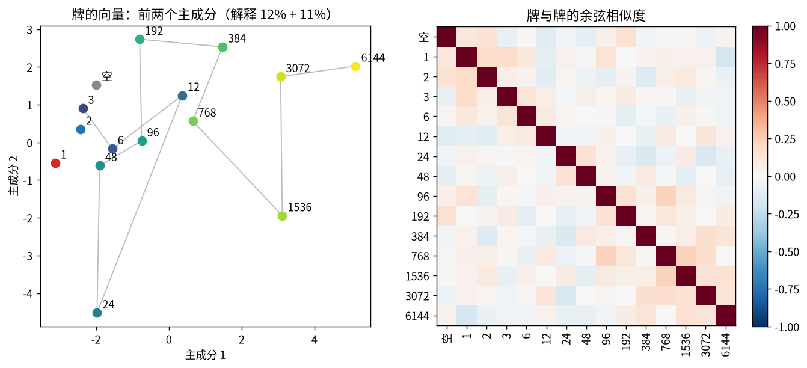
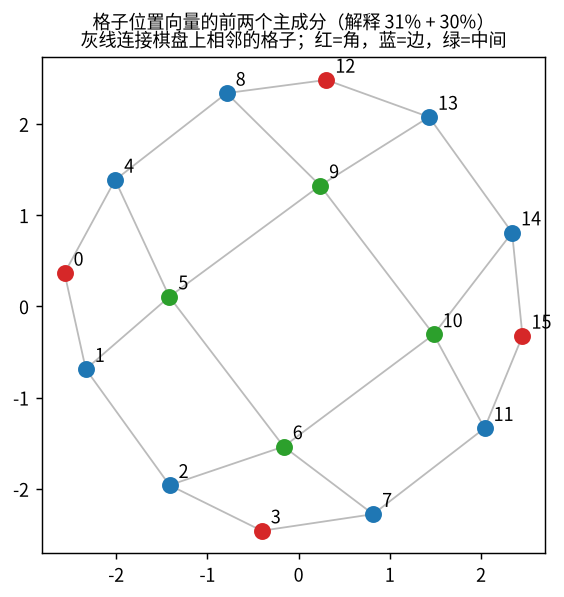
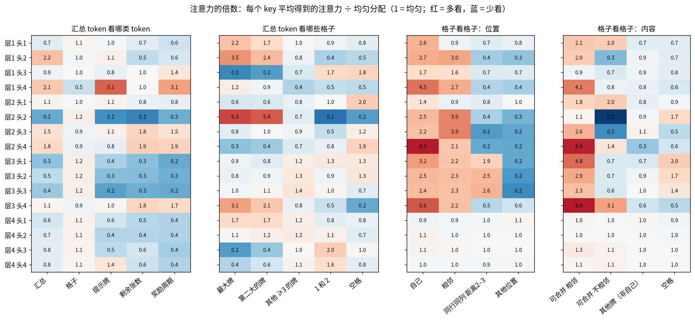
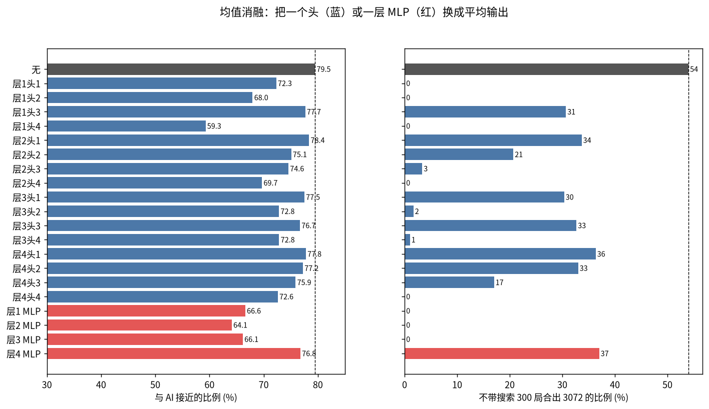
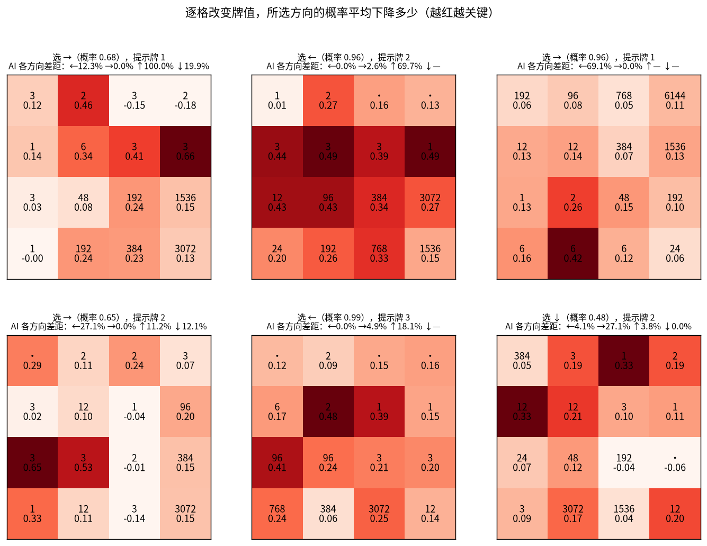

# V51：解读 V50 transformer 学到了什么

问题：V50 的小 transformer（DAgger 14，81 万参数）不带搜索就能在约 80% 的局面里走出和 6 层搜索几乎一样好的一步。它内部是怎么算的？

## 设置（运行前写定）

- **模型**：`training/v50-transformer/runs/dag14/model.pt`。4 层，宽 128，每层 4 个注意力头。
- **输入**：20 个 token。
  - 0 号是汇总 token，最后的决定从它读出。
  - 1–16 号是 16 个格子，按行排列。
  - 17–19 号依次是提示牌、剩余的 1/2/3 张数、奖励周期。
- **局面**：验证集（V46 奇数种子，模型没训练过）里随机取 3 万个局面，按对局划分训练和测试，用于探针。
- **代码**：`training/v51-interpret/common.py`。手写了一遍前向计算，和模型的输出一致（最大差 1e-5），可以取出每层的中间结果和每个头的注意力，也可以把任一个头或 MLP 的输出换成它在数据上的平均值（"均值消融"）。

四步：

1. **嵌入**（`embed.py`）：
   - 16 种牌的向量：用主成分分析和余弦相似度，看牌的大小是否排成一条线，1、2、3 是否特殊。
   - 16 个格子的位置向量：看是否分出角、边、中间。训练时做了 8 种旋转和镜像，所以预期不偏向任何一个角。
2. **注意力**（`attention.py`）：对每层每个头统计关注去向，都和"均匀关注"比，得到倍数：
   - 汇总 token 关注哪些 token；
   - 格子关注哪些格子：自己、相邻、同行同列、其他；
   - 按内容关注哪些格子：最大牌、和自己能合并的牌、空格。
3. **探针**（`probe.py`）：用每层的中间结果做线性回归（岭回归），在测试对局上报 R²，或报正确率。
   - 基线：直接用输入的 one-hot 做同样的回归。只有超过这个基线，才说明是模型"算出来"的。
   - 目标：
     - 整个局面：空格数、可合并的相邻对数、最大牌是否在角上、单调性、AI 对局里再过多少步合出更大的牌、AI 的估分；
     - 每个方向：V49 的 22 个特征；
     - 每个格子：这一格能否和相邻格合并、这一格是否被困住。
4. **消融**（`ablate.py`）：
   - 逐个把 16 个头和 4 个 MLP 换成平均输出，看验证集上接近率和大错率的变化，并让模型不带搜索玩 300 局，看平均分和 3072 达成率。
   - 在几个具体局面上，逐格改变牌的大小，看模型首选那一步的概率变化，画成热力图。

## 结果

全部脚本在本机几分钟内跑完。数字来自 `training/v51-interpret/*.json`，图在 `training/v51-interpret/fig/`。

### 1. 嵌入：它怎么"看"牌和格子

- **牌几乎被当作互不相关的符号**：
  - 相邻两种牌（如 96 和 192）的向量余弦相似度只有 0.0–0.2。
  - 有一个弱的"大小"方向：在 3 到 6144 之间，第一主成分和牌的大小相关 0.88，但只解释 12% 的差异。
  - 768–6144 这几张大牌彼此略相似（约 0.2）；1、2、3 彼此也略相似。
  - 12288 从来没在训练数据的盘面上出现过（合出它游戏就结束），这个向量没有训练过。
- **格子的位置向量自己拼出了棋盘**：
  - 前两个主成分（解释 61%）把 16 个格子排成一张 4×4 网格，只是转了个角度。
  - 两格的相似度和它们在棋盘上的距离相关 −0.81：相邻格平均 0.51，距离 5 的格平均 −0.69。
  - 它不偏爱任何一个角：在 8 种旋转镜像下，相似度矩阵平均只差 0.011，符合训练时做的对称增强。

### 2. 注意力：每个头在看哪里

数字是倍数：1 表示均匀分配，8.4 表示得到的注意力是均匀分配的 8.4 倍。

| 头 | 主要在看什么 |
|---|---|
| 层1头4 | 汇总 token 看提示牌（5.1）和奖励周期（3.1）；格子看相邻的可合并牌（4.1） |
| 层1头2、层2头2、层3头4（汇总 token） | 最大牌和第二大的牌（层2头2：6.3、5.4） |
| 层2头4、层3头4（格子） | **合并探测**：格子看相邻的可合并牌（8.4、8.8） |
| 层3头1–3（格子） | **沿行列看**：看同一行、同一列上距离 2–3 的格子（1.9–2.6），其他位置几乎不看（0.2） |
| 层1头3、层4头3、层4头4（汇总 token） | 1、2 和空格 |
| 第 4 层的格子 token | 均匀分配。最后的决定只从汇总 token 读出，第 4 层格子 token 的输出不起作用 |

### 3. 探针：它心里算出了什么

线性探针在测试对局上的结果。"基线"是直接用输入的 one-hot 做同样的回归，超过基线的部分才是模型算出来的。

| 目标（汇总 token） | 基线 | 最好的一层 | 出现在 |
|---|---:|---:|---|
| 再过几步会出现更大的牌（AI 对局，log） | 0.28 | **0.83** | 第 2 层 |
| 可合并的相邻对数 | 0.19 | 0.60 | 第 2 层 |
| 从最大牌出发的链长（V49） | 0.14 | 0.50 | 第 1 层 |
| AI 的估分（log） | 0.38 | 0.59 | 第 2 层 |
| AI 首选哪个方向（正确率） | 39% | 65% | 第 4 层 |
| 每个方向：合并次数 | 0.20 | 0.63 | 第 3–4 层 |
| 每个方向：合出的最大牌 | 0.13 | 0.58 | 第 3–4 层 |
| 每个方向：牌进入的通道数 | 0.45 | 0.77 | 第 4 层 |
| 每个方向：被移动的最大牌 | 0.51 | 0.80 | 第 4 层 |
| 每个方向：下一步还能合出的最大牌（setup） | 0.05 | 0.34 | 第 4 层 |
| 每个方向：会不会马上卡死（safe）/ 提示牌能否放好（fit） | −0.01 / 0.08 | 0.13 / 0.19 | — |

| 目标（格子 token，正确率） | 多数类 | 基线 | 最好的一层 |
|---|---:|---:|---|
| 这一格有相邻的可合并牌 | 75% | 76% | **99.7%**（第 2 层） |
| 这一格被困住（周围无空格、无可合并牌） | 58% | 81% | 98.0%（第 2 层） |
| 这一格是最大牌 | 94% | 97% | 99.4%（第 1 层） |
| 这一格的牌在某方向上会移动 | 70% | 79% | **98.1%**（第 3 层） |

第一张表中"AI 首选哪个方向"一行是正确率，其余是 R²；第二张表都是正确率。设置里写的"单调性"放在每个方向的特征里测（V49 的 mono：基线 0.46，第 3–4 层 0.60），没有单独测整个局面的单调性。

### 4. 消融：拿掉一部分会怎样

- **完整模型**：接近率 79.5%，300 局里 54% 合出 3072。
- **拿掉以下任何一个，整局都撑不住**（3072 达成率变成 0%）：
  - 层1头4（接近率降到 59.3%，平均只活 148 步）
  - 层1头2（68.0%）
  - 层2头4（69.7%）
  - 层1头1（72.3%）
  - 层4头4（72.6%）
  - 第 1–3 层的任一个 MLP（64–67%）
- **最不重要的**：层2头1、层4头1、层1头3、层3头1。接近率只降 1–2 个百分点，但 3072 达成率仍从 54% 降到 30–36%。
- **整局比单步脆弱得多**：例如层3头2，接近率只降 6.7 个百分点，3072 却从 54% 降到 2%。这和 V50 的发现一致：每步的小错会在几百步里累积。

**改格子的热力图**：

在 200 个后期局面上汇总（`occlusion.json`）：把一格改成别的值，所选方向的概率平均下降多少。

| 格子里是 | 平均下降 |
|---|---:|
| 最大牌 | 0.13 |
| 第二大的牌 | 0.12 |
| 其他 ≥6 的牌 | 0.16 |
| 3 | 0.16 |
| 1 或 2 | 0.17 |
| 空格 | 0.15 |

- 这一步会移动的格子平均下降 0.21，不动的格子 0.14。
- 模型的决定分散地依赖整个盘面，最依赖这一步会移动的"工作区"。它并不特别依赖最大牌在哪里，这一点和 V49 那些围绕最大牌的规则不同。

### 小结：它大致是怎么算的

1. **输入**：每张牌是一个独立的符号，带一点大小顺序；格子位置是一张自己学出来的 4×4 地图。
2. **第 1–2 层**：
   - 读提示牌和奖励周期；
   - 找出最大和第二大的牌；
   - 每个格子找出相邻的可合并牌，判断自己是否被困住（第 2 层后几乎 100% 可读出）。
   - 汇总 token 此时已经知道"离下一张更大的牌还有多远"（R² 0.83），这正是 V49 的简单规则缺少的多步信息。
3. **第 3 层**：格子沿自己的行和列看，算出每个方向上自己会不会滑动（98%）。
4. **第 3–4 层**：汇总 token 把这些合成为每个方向的后果，包括合并几次、合出多大、动不动最大牌、下一步能否接着合，然后做出选择。
5. **它没怎么算的**：这一步之后，新牌进来会不会立刻卡死（safe），提示牌放不放得好（fit）。这可能是它在后期仍会犯大错的原因之一，可以作为下一步改进的线索。

**注意**：
- 这些名字（"合并探测"、"沿行列看"）都是平均意义上的描述，一个头可能同时做几件事。
- 探针只说明"信息在那里、能线性读出"，不等于模型一定用了它。
- 改格子是很大的扰动，测的是敏感程度，不是推理过程。
- 消融的结果（拿掉某个头就崩）能支持"它有用"，但不能说明它具体怎么用。
