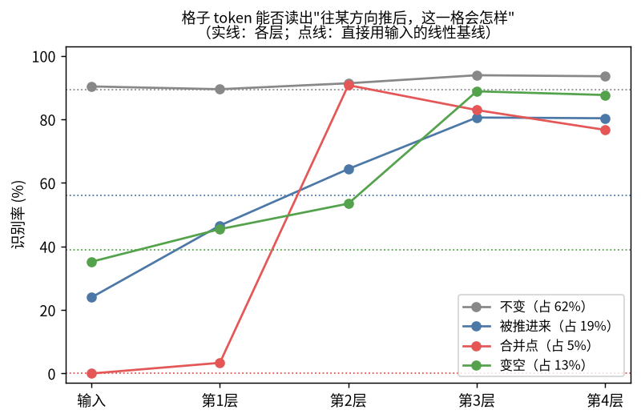
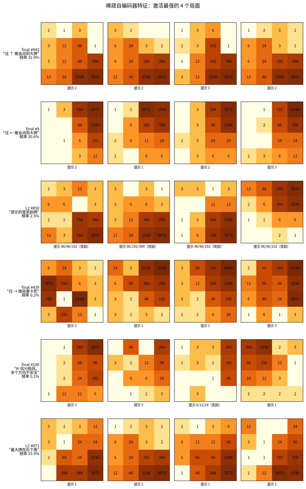
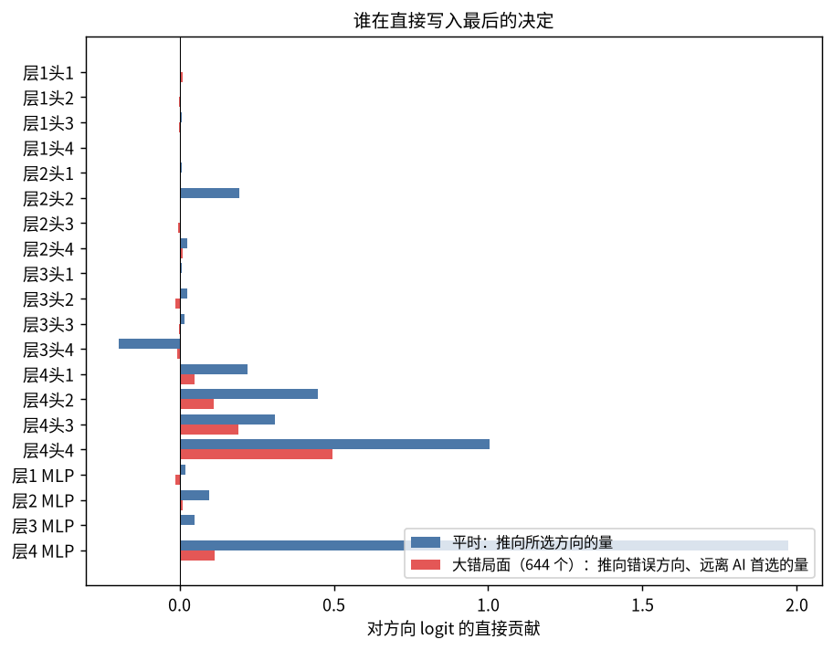

# V52：继续解读 V50 transformer（自由研究，约 3 小时）

接着 V51，研究同一个模型（V50 DAgger 14），代码在 `training/v52-interpret2/`，复用 V51 的 `common.py`（手写前向计算、均值消融）。

## 问题（运行前写定）

1. **它有没有在内部预演每一步？**
   - 用第 0–4 层的格子 token，线性预测"往某个方向推完之后（新牌进来之前），这一格是什么牌"。四个方向分开做。
   - 只看推完后会变化的格子才有意义（不变的格子照抄输入就行），所以单独报这部分的正确率。
   - 基线：用输入的 one-hot 加上这一格的位置和自身的牌，做同样的预测。
2. **大错在哪里？它自己知道没把握吗？**
   - 在验证集 3 万个局面里，找出模型选的方向比 AI 首选差 ≥5% 的局面。
   - 按阶段统计这些大错。
   - 用 V49 的特征比较"模型选的方向"和"AI 选的方向"，看哪些特征差别最大。
   - 用模型自己的信心（首选和次选的概率差、gap 输出头）预测它会不会犯大错。
   - 估算：如果只在没把握的局面上调用 AI 搜索，要调用多少次，能挽回多少大错、多少整局成绩。
3. **稀疏自编码器（SAE）**：
   - 在训练集局面上，取第 2 层后和最后（LayerNorm 后）的汇总 token，训练 128 → 1024 的稀疏自编码器。
   - 每个特征和一批已知量（V49 特征、各种牌的张数、最大牌的位置、提示牌、阶段、"再过几步出现更大的牌"等）算相关，自动起名，再看激活最强的局面。
   - 报告：多少特征能对上已知量，以及几个对不上的。
4. **因果验证**：
   - 在第 2 层汇总 token 上，沿 V51 探针找到的"再过几步出现更大的牌"方向加减一段，看模型的选择怎么变。
   - 比较选中方向的 V49 特征（合并次数、动不动最大牌等）是否随之系统地变化。

研究中途又加了两个问题：

5. **谁直接写入最后的决定**：直接 logit 归因，把输出拆成各个头和 MLP 的贡献；并检验大错由谁推动。
6. **它对旋转镜像是否一致**：8 个变换的选择是否相同；把 8 个变换的判断平均起来，会不会玩得更好。

## 结果

数字来自 `training/v52-interpret2/*.json`。除另行说明外，都基于验证集的 3 万个局面，以及从种子 50900001 起的 300 局整局。

### 1. 它在内部预演每一步吗？——预演了"谁动、在哪合并"，但读不出合并后的牌值

用格子 token 线性预测"往某方向推后，这一格会怎样"（四个方向的平均）：

| 这一格会 | 占比 | 输入基线 | 第 2 层 | 第 3 层 |
|---|---:|---:|---:|---:|
| 不变 | 62% | 89% | 91% | 94% |
| 被后面的牌推进来 | 19% | 56% | 64% | 81% |
| 成为合并点 | 5% | **0%** | **91%** | 83% |
| 变空 | 13% | 39% | 54% | 89% |
| 总正确率 | | 72% | 81% | **90%** |

- **合并点在第 2 层出现**：此时这一格能认出"往这个方向推，我这里会发生合并"，直接看输入的线性模型完全认不出来。这和 V51 的合并探测头对得上。
- **滑动在第 3 层补齐**：被推进来、变空的识别率在第 3 层大幅上升，和 V51 发现的第 3 层沿行列看的头对得上。
- **牌值读不出来**："推完后这一格具体是哪张牌"（16 选 1）读不出来：会变化的格子最多 40%，合并点不到 8%。模型知道哪里会合并，但没有显式算出合并后的牌值；牌在它眼里是互不相关的符号（V51），"加一级"不是线性可读的运算。

### 2. 大错在哪里？它自己知道吗？

| 阶段（最大牌） | ≤384 | 768 | 1536 | 3072 | 6144 |
|---|---:|---:|---:|---:|---:|
| 大错率 | 0% | 0.5% | 0.8% | 3.0% | 4.8% |

- **大错只在后期**：384 以前一个都没有。
- **错误的方向偏"贪心"**：和 AI 的首选比，模型在大错时选的方向合并更多（+0.21 个标准差）、下一步能合出大牌的机会更多（setupBig +0.20）、合出的牌更大（+0.18）、下一步能合的更多（setup +0.16）。
  - 在"选得不同但差不多好"的局面里，合并数也偏多（+0.24），但 setup 不偏（+0.02）。
  - 所以大错的特点是：为了眼前和下一步的合并，走了 AI 认为长远更差的方向。
- **它基本不知道自己要犯错**：
  - 用"首选方向的概率"区分大错和其他局面，AUC 只有 0.66。最没把握的 20% 局面里，只包含 36% 的大错。
  - gap 输出头给出的差距完全没用（AUC 0.42，比瞎猜还差）。

### 3. 稀疏自编码器：它内部的"概念"

在训练局面（60 万 AI 局面 + 20 万学生自己的局面）上，对汇总 token 训练 128 → 1024 的稀疏自编码器。λ 扫了 0.004、0.02、0.05、0.1，选 0.02。

| 位置 | 平均同时激活 | 未解释方差 | 常用特征（频率 ≥0.1%） | 用重建替换后的接近率 |
|---|---:|---:|---:|---:|
| 第 2 层后 | 13.5 个 | 19% | 248 | 79.2%（原 79.5%） |
| 最后（LayerNorm 后） | 10.7 个 | 21% | 555 | 76.5% |

- **最常见的特征**：最大牌在哪个格子；**往某个方向推会不会动到大牌**（四个方向各有一组，最后一层最常见的 9 个特征几乎都是这一类）；空格多少。
- **很专一的特征**：
  - 提示的是奖励牌（激活时这个量高出平均 3–4 个标准差，第 2 层有十几个这样的特征）；
  - 最大牌在中间格（少见、危险的局面）；
  - 少数"危险"特征：AI 估分极低、某个方向推了就卡死。
- **能自动对上已知量的不多**：最后一层 555 个常用特征里，只有 30 个在激活时某个已知量高出 2 个标准差以上。大部分特征是这些量的组合，或者是我们的量表里没有的东西。

### 4. 因果验证

**(a) 汇总 token 的中间结果有多重要**：把第 k 层后的汇总 token 换成平均值。

| | 接近率 | 大错 | 平均分 | 3072 |
|---|---:|---:|---:|---:|
| 原样 | 79.5% | 2.1% | 189,422 | 54% |
| 第 1 层后替换 | 77.9% | 2.7% | 157,439 | 47% |
| 第 2 层后替换 | 76.1% | 2.9% | 114,342 | 30% |
| 第 3 层后替换 | 75.3% | 3.1% | 103,134 | 23% |

汇总 token 在前几层收集的信息有用，但不是唯一来源：大部分信息存在格子 token 里，最后一层还会重新读取。

**(b) 特征怎么影响决定**（直接 logit 效应，最后一层）：

| 特征类型 | 特征数 | 压低自己那个方向的比例 |
|---|---:|---:|
| "往某方向推会动到大牌" | 79 | **87%** |
| "往某方向推会动到最大牌" | 36 | 72% |
| "往某方向推，牌进入的通道多" | 14 | 86% |
| "AI 首选某方向" | 20 | 0%（全部抬高那个方向） |

模型的头号规则读得很清楚：**往哪个方向推会动到大牌，就不往那个方向推**。

**(c) 探针读得出 ≠ 模型在用**：
- 做法：V51 在第 2 层的汇总 token 里读出了"再过几步出现更大的牌"（R² 0.83）。我沿这个探针方向把汇总 token 推 ±1 到 ±3 个标准差。
- 结果：只改变了 1–3% 的选择，接近率和所选方向的各项特征都没有系统变化。
- 结论：这个信息在那里，但模型几乎不用它。

### 5. 谁直接写入最后的决定

- **最后的投票几乎全部来自第 4 层**：
  - 第 4 层 MLP 贡献 +1.97；
  - 第 4 层的四个头合计 +1.99，其中第 4 头 +1.00。
  - 第 2 层第 2 头（看最大牌）+0.19，第 3 层第 4 头 −0.20，两者大致抵消。
- **大错局面里把模型推向错误方向的**：主要是第 4 层第 4 头（+0.50）和第 3 头（+0.19）；第 4 层 MLP 只有 +0.11。V51 发现这两个头看的是 1、2 和空格。
- **因果检验没有支持"它们导致了大错"**（`scale.json`）：
  - 把这两个头的输出乘以 0.5 或 0.75，大错不减反增，整局变差（×0.5 时 3072 达成率从 54% 降到 29%）。
  - 乘以 1.25 时略好（3072 57%，6144 11.7%），但在 300 局的噪声范围内。
  - 归因说明这两个头参与了错误，但错误不是因为它们"声音太大"，而是它们读到的局部信息本身就把模型引向那一步。

### 6. 旋转镜像一致性

- **单个局面**：8 种变换下的选择全部相同的局面占 79%；平均有 94% 的变换选同一个方向。
- **8 个变换平均**：接近率 79.8%（单个 79.5%），大错 2.08%（单个 2.15%）。
- **300 局整局**：

| | 平均分 | 1536 | 3072 | 6144 |
|---|---:|---:|---:|---:|
| 单个模型 | 189,422 | 87% | 54% | 8.3% |
| 8 个变换平均 | **220,570** | 88% | **60%** | **13.3%** |

把 8 个变换的判断平均起来，单步只好一点点，但整局明显变好：3072 多 6 个百分点，约 2 个标准误。代价是计算量变成 8 倍，但仍然不需要搜索。

### 7. 只在没把握时调用搜索

第 2 节说模型"基本不知道自己要犯错"（AUC 0.66）。这一节换个问法：它的信心够不够用来决定"什么时候请老师"？

- 做法：300 局整局（`hybrid.py`），每一步先看模型首选方向的概率。低于门槛，就改用网站 AI 的 6 层搜索（`bin/label`）来走这一步。
- 三个门槛分别对应验证集里最没把握的 10%、20%、30% 局面。对照组是在随机 20% 的步上调用搜索。

| | 调用搜索的步 | 平均分 | 1536 | 3072 | 6144 | 12288 |
|---|---:|---:|---:|---:|---:|---:|
| 只用模型 | 0% | 189,422 | 87% | 54% | 8.3% | 0% |
| 最没把握的约 10% | 11.9% | 250,237 | 93% | 66% | 16.7% | 0% |
| 最没把握的约 20% | 22.2% | 360,074 | 97% | **81%** | **32.3%** | 1.3% |
| 最没把握的约 30% | 32.5% | **387,071** | 97% | **84%** | **35.0%** | 1.7% |
| 随机 20%（对照） | 20.0% | 268,720 | 94% | 71% | 18.0% | 0.3% |
| 参照：网站 AI 每步都搜索（V43） | 100% | | | 97% | 74% | 11.7% |

- **信心是有用的信号**：搜索的步数一样多（约 20%），挑模型没把握的步，比随机挑的步好得多：3072 达成率 81% 对 71%，6144 32% 对 18%。差距约 3–4 个标准误。
- 实际调用比例比门槛对应的比例略高（11.9% 对 10%，22.2% 对 20%），因为整局里后期局面更多，后期模型也更没把握。
- **收益递减**：从 20% 加到 30%，只多了 3 个百分点。剩下的差距不在"没把握"的步里，而在模型很有把握却走错的步里，这和第 2 节一致：大错的 AUC 只有 0.66。
- **和第 2 节并不矛盾**：单步看，信心挡不住大部分大错（最没把握的 20% 只含 36% 的大错）。但整局的成绩取决于后期大量"差一点"的步；把最犹豫的那 20% 交给搜索，加上第 6 节的对称平均，就是目前不重新训练能拿到的最大改进。
- 注：第一次运行卡死了 3 个半小时，原因是 `label` 用 ifstream 读 `/dev/stdin`，要等缓冲区装满才返回。已改为输入写 `-` 时读 `std::cin`（`training/v50-transformer/label.cpp`）。

## 小结

1. **它怎么算**（V51 + 本篇第 1、5 节）：
   - 第 2 层认出"往哪个方向推，哪里会合并"；
   - 第 3 层补齐"哪些格会滑、哪些格会变空"；
   - 第 4 层（主要是 MLP 和第 4 头）把这些汇总成最后的投票。
   - 它预演"谁动"，但不算"变成什么牌"。
2. **它学到的头号规则**是"别往会动到大牌的方向推"（第 3、4 节）：
   - 稀疏自编码器里最常见的特征就是这一类；
   - 87% 的这类特征直接压低自己那个方向。
3. **它的错**集中在 3072 以后，方向偏贪心：为了眼前和下一步的合并，走了长远更差的一步（第 2 节）。
4. **读得出 ≠ 在用**：
   - "再过几步出现更大的牌"在内部可以读出（R² 0.83），但沿这个方向推动内部状态，选择几乎不变（第 4 节）；
   - 归因指向第 4 层第 3、4 头推动了大错，但削弱它们只会更差（第 5 节）。
5. **能直接用上的两点**：
   - 8 个旋转镜像的判断取平均：3072 达成率从 54% 到 60%（第 6 节）；
   - 只在最没把握的约 20% 步上调用搜索：3072 从 54% 到 81%，6144 从 8% 到 32%（第 7 节）。
   - 两者还没有一起试过。
