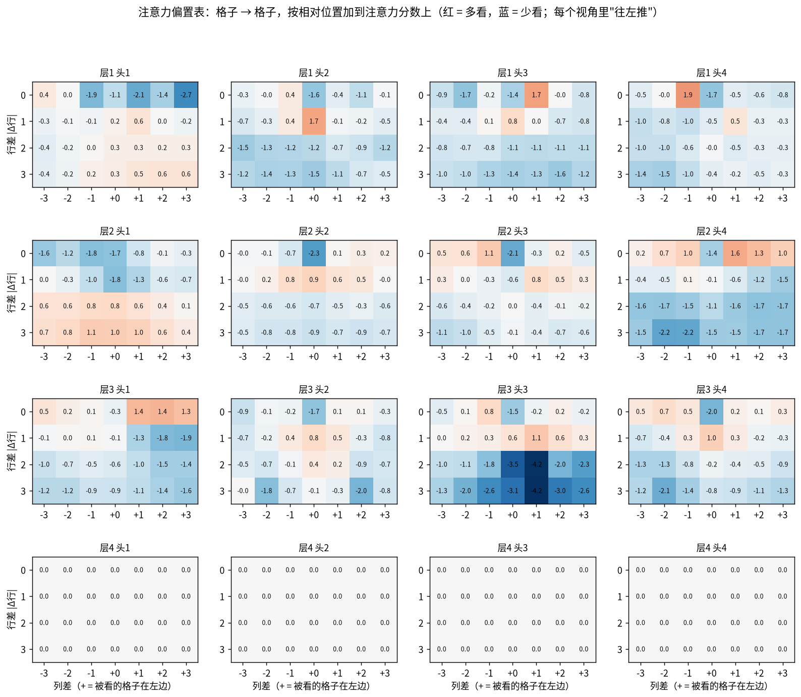
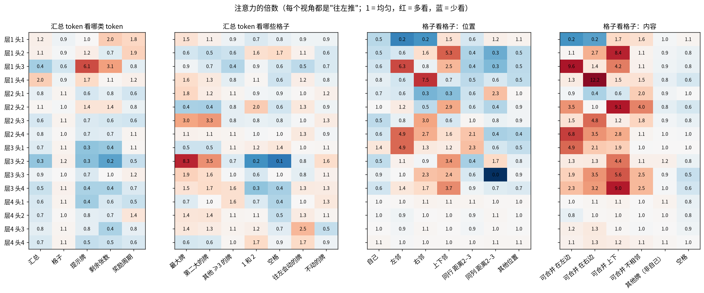
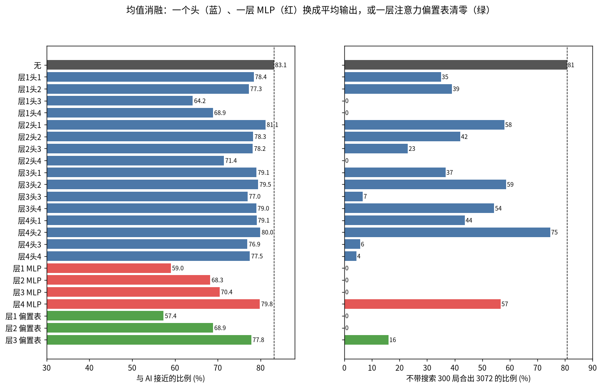

# V57：解读 shared 模型（V55 第 21 轮）

V51、V52 解读了 V50 的模型（dag14）。V54 的 shared 结构换了一种算法：每个方向单独跑一遍网络，每遍只判断"往左推好不好"。V55 用它跑 DAgger 到第 21 轮，只用模型不搜索，就能在 80% 的局面里合出 3072（dag14 是 53%）。这里用同一套方法解读它，并和 dag14 对比。

代码在 `training/v57-interpret-shared/`。

## 设置（运行前写定）

**模型**：`training/v55-shared-dagger/runs/r21/model.pt`。
- 4 层，宽 128，每层 4 个注意力头，0.81M 参数，和 dag14 一样大。
- 判断方向 d 时，先把棋盘转到"d = 往左"，再跑一遍网络，从汇总 token 读出一个分数（另有一个 gap 输出）。四个方向的分数比大小，各遍之间互不通信。
- 下面把"一个局面转到某个方向后跑的那一遍"叫做**一个视角**。分析的单位是视角：3 万个局面，就是 12 万个视角。
- 输入还是 20 个 token：汇总、16 个格子、提示牌、剩余张数、奖励周期。
- 和 dag14 的不同：
  - 格子的位置向量只有 8 个：列号 × 边行还是中间行；
  - 每层每个头有一张 4×7 的注意力偏置表，按两格的行差绝对值和列差取值，只加在格子之间。

**局面**：和 V51、V52 相同，验证集（V46 奇数种子，没训练过）随机 3 万个局面，按对局划分训练和测试，用于探针。

**代码**：`common.py` 手写一遍前向计算，含注意力偏置，和模型输出核对。可以取出每层的中间结果、每个头的注意力，并做均值消融。

**分析**（基本沿用 V51、V52，改成按视角）：
1. **嵌入**（`embed.py`）：
   - 16 种牌的向量：主成分，相邻牌的相似度，和 dag14 比；
   - 8 个位置向量；
   - 16 张注意力偏置表：每个头偏向看哪些相对位置（左边、右边、同列、远处）。
2. **注意力**（`attention.py`）：倍数的算法和 V51 相同。因为"左"在每个视角里都是固定的，可以区分左邻、右邻、上下邻。
   - 汇总 token：看哪类 token；看哪些格子（最大牌、第二大、1/2、空格、往左推会动的格子）。
   - 格子看格子：按位置、按内容（可合并的牌在左边、右边、上下）。
3. **探针**（`probe.py`）：岭回归，测试对局上的 R² 或正确率，基线是视角棋盘的 one-hot 加提示牌。
   - 汇总 token：
     - 这一步（往左）的 V49 特征；
     - AI 对这一步的估分（log）；
     - 这一步比 AI 首选差多少（gap）；
     - 这一步是不是 AI 首选；
     - 整个局面的量：空格数、可合并的相邻对数、链长、再过几步出现更大的牌。
   - 格子 token：这一格有可合并的相邻牌、左边紧挨着就是可合并的牌、往左推会动、被困住、是最大牌。
4. **消融**（`ablate.py`）：
   - 逐个把 16 个头、4 个 MLP 换成平均输出，再逐层把注意力偏置表清零；
   - 测验证集接近率、大错率，以及 300 局整局（种子 50900001 起，只用模型）。
   - 另做 200 个后期局面的逐格改值（遮挡），按格子里是什么牌、往所选方向推会不会动来分组。
5. **预演**（`simulate.py`）：用格子 token 线性预测"往某方向推之后这一格会怎样"（不变、被推进来、合并点、变空）。
   - shared 的每个视角只判断往左，所以主要看往左。
   - 同时也测另外三个方向，看它是不是只预演了自己要判断的那一步。
6. **大错和信心**（`errors.py`）：
   - 大错率按阶段统计；
   - 大错时所选方向和 AI 首选方向的 V49 特征差；
   - 用首选概率、概率差、gap 输出预测大错（AUC）。
7. **分数是什么**（`score.py`，新问题）：每个视角看不到别的方向，却要给出一个能和别的方向直接比较的分数。
   - 这个分数和 AI 对这一步的估分有多相关：同一局面的四个方向之间、不同局面之间分别算；
   - 和"这一步比首选差多少"有多相关。
8. **谁写入决定**（`dla.py`）：把每个视角的分数精确拆成嵌入、各个头、各层 MLP 的贡献。
   - 决定：所选方向减去其他合法方向的平均；
   - 大错局面：所选方向减去 AI 首选方向。
9. **稀疏自编码器**（`sae.py`）：第 2 层后和最后的汇总 token，128 → 1024，λ = 0.02，其他和 V52 相同。
   - 训练数据：60 万个 AI 局面加 20 万个第 21 轮学生的局面，每个局面 4 个视角；
   - 给特征命名用的量换成按视角的版本：这一步的 V49 特征、AI 对这一步的估分、是否首选、视角里最大牌的位置等。
10. **因果**（`causal.py`）：
    - (a) 把第 k 层后的汇总 token 换成平均值，测验证集和 300 局；
    - (b) 最后一层 SAE 特征对分数的直接作用。

**和 dag14 对比**：dag14 的数字直接取 V51、V52 的结果。

**注意**：dag14 的一个汇总 token 要同时管四个方向；shared 的一个汇总 token 只管一个方向。所以按方向的探针，两者的含义不同：
- dag14 是从一个 token 里分别读出四个方向的量，再取平均；
- shared 是在每个视角里读这一步自己的量。

## 结果

数字来自 `training/v57-interpret-shared/*.json`，图在 `training/v57-interpret-shared/fig/`。手写前向和模型的最大差 1.6e-5。在这 3 万个局面上，接近率 83.1%、大错率 1.77%（dag14：79.5%、2.15%）。

### 1. 嵌入和偏置表

- **牌的大小排得更整齐**：

  | | 第一主成分和牌大小（3–6144）的相关 | 相邻牌的平均相似度 |
  |---|---|---|
  | dag14 | 0.88 | 0.10 |
  | shared | **0.98** | **0.24** |

  shared 的牌向量带着更明显的"大小"方向，不再接近互不相关的符号。
- **第 4 层的偏置表全是 0**：第 4 层格子之间的注意力不影响输出（只从汇总 token 读出），这张表没有得到过梯度。和 V51"第 4 层格子 token 不起作用"一致。
  - 由此可以省掉计算：第 4 层只给汇总 token 算查询和 MLP，其他 token 只提供键和值（`lastlayer.py`，事后补测）。
  - 分数最大差 5e-6，选择 100% 相同。
  - 单核 CPU 上每个局面：一次一个从 0.81 降到 0.71 毫秒，一次 64 个从 0.43 降到 0.34 毫秒。
- **第 1–3 层的偏置表**（`fig/bias.png`）各有明确的相对位置：

  | 头 | 偏置最大的位置 | 意思 |
  |---|---|---|
  | 层1头3 | 同行、左边一格（+1.7） | 看左邻 |
  | 层1头4 | 同行、右边一格（+1.9） | 看右邻 |
  | 层1头2 | 同列、上下一格（+1.7） | 看上下邻 |
  | 层2头4、层3头1 | 同行、左边所有格子（+1.0 到 +1.6） | 看这一行左边的整段 |
  | 层3头3 | 同行和相邻行；隔一行以上 −2 到 −4 | 只看附近两行 |
  | 层2头1 | 隔两三行（+0.6 到 +1.1） | 看远处的行 |

### 2. 注意力

数字是倍数：1 表示均匀分配。

| 头 | 主要在看什么 |
|---|---|
| 层1头3 | **左边的可合并牌**（9.6）；汇总 token 看提示牌（6.1）和剩余张数（3.1） |
| 层1头4 | **右边的可合并牌**（12.2） |
| 层1头2、层2头2、层3头4 | **上下的可合并牌**（8.4、9.1、9.0） |
| 层2头4、层3头1 | 左邻（4.9）和左边的可合并牌（6.8、4.9） |
| 层2头3、层3头2（汇总 token） | **最大牌和第二大的牌**（层3头2：8.3、3.5） |
| 层4头3（汇总 token） | **往左推会动的牌**（2.5，不动的 0.5） |
| 层4头4（汇总 token） | 会动的牌（1.7）、1 和 2（1.7） |
| 第 4 层的格子 token | 均匀分配（不起作用） |

和 dag14 一样有"合并探测"和"盯最大牌"的头。不同的是：shared 在第 1 层就把左、右、上下分给了三个头，因为"左"在每个视角里都是固定的。

### 3. 探针

**汇总 token：这一步自己的量**（R²；基线 = 视角棋盘的 one-hot 加提示牌）

| 目标 | 基线 | 第1层 | 第2层 | 第3层 | 第4层 | dag14 最好 |
|---|---|---|---|---|---|---|
| 这一步比首选差多少（≤10%） | 0.43 | 0.46 | 0.51 | 0.64 | **0.82** | — |
| AI 对这一步的估分（log） | 0.14 | 0.16 | 0.20 | 0.26 | **0.58** | — |
| 合并次数 | 0.21 | 0.20 | **0.58** | 0.49 | 0.44 | 0.63 |
| 牌进入的通道数 | 0.46 | 0.43 | 0.75 | **0.86** | 0.74 | 0.77 |
| 被移动的最大牌（movedBig） | 0.57 | 0.57 | 0.66 | **0.84** | 0.79 | 0.80 |
| 下一步还能合出的最大牌（setup） | 0.06 | 0.06 | 0.18 | 0.31 | **0.42** | 0.34 |
| **会不会马上卡死（safe）** | 0.01 | 0.03 | 0.05 | 0.11 | **0.57** | 0.13 |
| 提示牌能否放好（fit） | 0.09 | 0.26 | **0.36** | 0.27 | 0.31 | 0.19 |

- **最大的不同是 safe**：这一步走完、新牌进来后会不会马上卡死，dag14 几乎没算（0.13），shared 在第 4 层能读出 0.57。V51 曾猜测"没算 safe"是 dag14 后期犯大错的原因之一。
- 整个局面的量（再过几步出现更大的牌：第 3 层 0.67，基线 0.31）也能读出，但比 dag14（0.83）低。shared 的汇总 token 更专注"这一步"。

**格子 token**（正确率；多数类 / 基线 / 最好的一层）

| 目标 | 多数类 | 基线 | 最好 |
|---|---|---|---|
| 这一格有相邻的可合并牌 | 75% | 76% | **97.8%**（第 1 层） |
| 左边紧挨着可合并的牌 | 93% | 93% | **99.5%**（第 1 层） |
| **往左推会动**（本视角判断的一步） | 70% | 79% | **99.0%**（第 2 层） |
| 往右推会动 | 70% | 79% | 88.9%（第 1 层） |
| 往上 / 往下推会动 | 70% | 79% | 75.5%（第 1 层，低于基线） |
| 这一格被困住 | 58% | 81% | 95.0%（第 1 层） |
| 这一格是最大牌 | 94% | 97% | 98.7%（第 1 层） |

（dag14：会合并 99.7%、被困 98.0%，都在第 2 层；某方向会移动 98.1%，四个方向平均，在第 3 层。）

### 4. 预演：只预演自己要判断的那一步

用格子 token 线性预测"往某方向推之后这一格会怎样"：

| 方向 | 输入基线 | 第1层 | 第2层 | 第3层 | 第4层 |
|---|---|---|---|---|---|
| **往左（本视角判断的一步）** | 71% | 88% | **96%** | 92% | 88% |
| 往右 | 71% | 86% | 84% | 78% | 75% |
| 往上 | 71% | 69% | 68% | 67% | 66% |
| 往下 | 71% | 69% | 68% | 67% | 66% |

- 往左：合并点在第 1 层就有 95%，被推进来、变空在第 2 层 97% 和 92%。dag14 平均四个方向，最好是第 3 层的 90%，合并点 91% 在第 2 层。
- 往上、往下：每层都不如直接看输入。每个视角完全不去算自己不判断的方向。往右能部分读出，是因为同一行里左右的合并对是同一对。
- 所以 shared 的预演比 dag14 早一层、准确得多。dag14 要在同一组格子 token 里同时预演四个方向，shared 每遍只预演一个。

### 5. 消融

完整模型：接近率 83.1%，300 局 81% 合出 3072。

- **拿掉以下任何一个，整局都撑不住**（3072 达成率 0–1%）：
  - 层1头3（左边的可合并牌 + 提示牌）
  - 层1头4（右边的可合并牌）
  - 层2头4（左邻）
  - 第 1–3 层的 MLP
  - 第 1、2 层的偏置表（清零后接近率降到 57% 和 69%）
- **影响很大**：层3头3（7%）、层4头3（6%）、层4头4（4%）、第 3 层偏置表（16%）。
- **最不重要**：层4头2（75%）、层3头2（59%）、层2头1（58%）、第 4 层 MLP（57%）。
- 和 dag14 一样：整局比单步脆弱得多。例如层3头3 接近率只降 6 个百分点，3072 却从 81% 降到 7%。
- **相对位置偏置是必需的**：清掉第 1 层的偏置表，比拿掉任何一个头都严重。shared 的位置向量只分列号和边行/中间行，"谁在谁左边"主要靠这张表。

**改格子**（200 个后期局面，所选方向的概率平均下降）：最大牌 0.19，第二大 0.14，其他 ≥6 的牌 0.19，3 是 0.20，1 或 2 是 0.20，空格 0.23。会移动的格子 0.23，不动的 0.18。和 dag14 一样：分散地依赖整个盘面，最依赖会移动的工作区。

### 6. 大错和信心

| 阶段（最大牌） | ≤384 | 768 | 1536 | 3072 | 6144 |
|---|---|---|---|---|---|
| shared 大错率 | 0% | 0.2% | 0.5% | 2.2% | 4.5% |
| dag14 大错率 | 0% | 0.5% | 0.8% | 3.0% | 4.8% |

- 各阶段都比 dag14 少。6144 阶段只少一点，大错仍然集中在最后。
- **错误方向依然偏贪心**：大错时，所选方向比 AI 首选：
  - 进入的通道更多（+0.21 个标准差）、动到大牌更多（+0.21）；
  - 合出的牌更大（+0.17）、合并更多（+0.15）、下一步能合的更多（+0.15）。
  - 和 dag14 的特点一样：为了眼前和下一步的合并，走了长远更差的一步，而且常常因此动到大牌。
- **它仍然不知道自己要犯错**：首选概率区分大错的 AUC 0.65（dag14 0.66）。最没把握的 20% 只含 31% 的大错。gap 输出头还是没用（AUC 0.50）。

### 7. 分数是什么：一把绝对的"差距尺子"

每个视角看不到其他方向，却要给出能和它们直接比较的分数。

| | 相关 |
|---|---|
| 分数和"这一步比首选差多少"（所有合法视角） | **−0.82** |
| 同一局面内，减去平均后和差距 | −0.79 |
| 同一局面四个方向的排序和 AI 估分的排序（Spearman，≥3 个合法方向） | **0.83** |
| 分数和 AI 对这一步的估分（log） | 0.18 |
| 一个局面的平均分数和 AI 对局面的估分（log） | **0.04** |

分数的差异只有 14% 来自"局面之间"。也就是说，网络没有学"这个局面好不好"，学的是"这一步比最好的一步差多少"的绝对刻度（分数的 1%–99% 分位是 −15 到 +3）。不同局面用的是同一把尺子，所以各算各的也能比。

### 8. 谁写入分数

把每个视角的分数精确拆开（"决定" = 所选方向减去其他合法方向的平均；总量 5.55）：

| 部件 | 决定 | 大错局面里推向错误方向 |
|---|---|---|
| 层4 MLP | **+1.79** | +0.35 |
| 层4头3（看会动的牌） | **+1.41** | +0.28 |
| 层4头4（看会动的牌、1 和 2） | +0.85 | +0.21 |
| 层4头1 | +0.42 | +0.28 |
| 层4头2 | +0.21 | +0.03 |
| 层2头2 | +0.20 | +0.01 |
| 层3 MLP | +0.20 | +0.07 |
| 层3头2（看最大牌） | +0.19 | 0.00 |
| 其余 | 各 ≤ 0.15 | |

- 和 dag14 相同：几乎全部来自第 4 层（MLP 和四个头）。
- 不同的是：
  - dag14 的大错主要由一个头（层4头4，+0.50）推动；
  - shared 推向错误方向的力分散在第 4 层的 MLP 和三个头上（合计 1.24），没有一个"罪魁祸首"。

### 9. 稀疏自编码器

| 位置 | 平均同时激活 | 未解释方差 | 常用特征 | 用重建替换后的接近率 |
|---|---|---|---|---|
| 第 2 层后 | 19.5 个 | 21% | 464 | 82.5%（原 83.1%） |
| 最后 | 24.9 个 | 24% | 941 | 80.7% |

（dag14：第 2 层 13.5 个、19%，替换后 79.2%（原 79.5%）；最后 10.7 个、21%，替换后 76.5%。）

- **最常见的特征都是"这一步差多少"**：最后一层频率最高的 8 个特征里，7 个在激活时"这一步比首选差"高出 0.8–1.6 个标准差，同时"这一步动到大牌 / 最大牌"也高出 0.7–1.4 个标准差。
- **"最大牌在视角的哪一列"是第二类常见特征**：
  - 最大牌在第 1 列（左边，往左推就是推向它）的特征，激活时"这一步差多少"偏低；
  - 最大牌在第 4 列（推离它）的特征，"这一步差多少"偏高。
  - 这就是"把牌往最大牌那边推"的角落策略。
- 能干净对上一个已知量的特征比 dag14 少：最后一层只有 14 个在激活时某个量高出 2 个标准差以上（dag14 30 个）。大部分特征是"这一步差多少"和几种棋形的组合。

### 10. 因果

**(a) 把第 k 层后的汇总 token 换成平均值**：

| | 接近率 | 大错 | 平均分 | 3072 | 6144 |
|---|---|---|---|---|---|
| 原样 | 83.1% | 1.8% | 324,628 | 81% | 28.0% |
| 第 1 层后替换 | 79.2% | 2.9% | 161,879 | 51% | 4.0% |
| 第 2 层后替换 | 77.8% | 3.1% | 139,647 | 40% | 3.0% |
| 第 3 层后替换 | 75.1% | 3.2% | 89,755 | 19% | 0% |

（dag14 对应：3072 54% → 47%、30%、23%。）和 dag14 一样：汇总 token 中途收集的东西有用，但大部分信息在格子 token 里，最后一层会重新读。

**(b) 最后一层 SAE 特征对分数的直接作用**（按激活时最突出的量分组，"量高 → 分数高"的比例）：

| 特征类型 | 特征数 | 量高时抬高分数的比例 |
|---|---|---|
| 这一步比首选差 | 112 | **4%**（几乎全部压低） |
| 这一步是 AI 首选 | 38 | **100%** |
| 这一步不动大牌（bigStill） | 12 | **100%** |
| 这一步走完有牌被困住（trapped） | 14 | **7%** |
| 这一步动到最大牌（movedMax） | 61 | 23% |
| 这一步动到大牌（movedBig） | 19 | 26% |
| 视角里最大牌在第 1 列（推向它） | 45 | 71% |
| 视角里最大牌在第 4 列（推离它） | 37 | 22% |
| 这一步后单调（mono） | 45 | 82% |
| 这一步合并多（merges） | 9 | 89% |

规则读得很清楚：**别动大牌、往最大牌那边推、别把牌困住、保持单调**。合并多会加分，这也是它偏贪心的来源。

## 小结

1. **它怎么算**：
   - 第 1 层：三个头分别找左边、右边、上下的可合并牌（靠相对位置偏置表定位），并读提示牌；
   - 第 2 层：预演完"往左推后每一格会怎样"（96%），比 dag14 早一层、更准；
   - 第 3 层：盯最大牌，沿这一行往左看；
   - 第 4 层：MLP 和看"会动的牌"的头把这些合成一个分数。
2. **分工更单纯**：每个视角只预演、只判断自己那一步，上下推会怎样完全不算。dag14 要在一组 token 里同时管四个方向。
3. **分数是一把绝对的差距尺子**：和"这一步比最好的差多少"相关 −0.82，和局面本身好坏几乎无关（0.04）。所以四个方向各算各的，也能直接比较。
4. **比 dag14 多算了一样东西**：这一步走完会不会马上卡死（safe 0.57 对 0.13）。这可能是它后期大错更少的原因之一。
5. **没变的**：
   - 头号规则仍是"别动大牌，往最大牌那边推"；
   - 大错仍集中在 3072 以后、方向偏贪心；
   - 它仍不知道自己什么时候会犯错（AUC 0.65）；
   - 整局对每个部件都很敏感。

**注意**（同 V51、V52）：
- 头的名字是平均意义上的描述；
- 探针读得出不等于模型在用；
- 消融说明"有用"，不说明"怎么用"。
